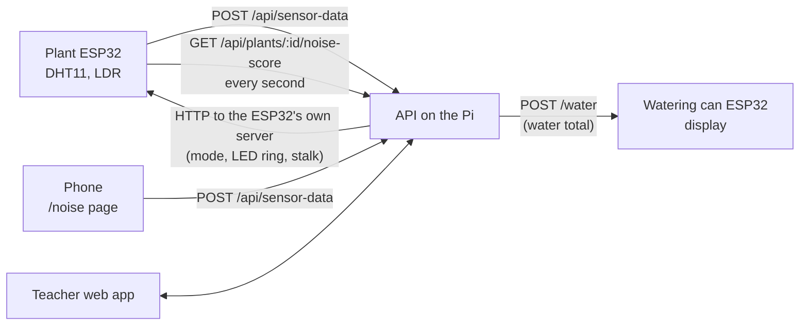
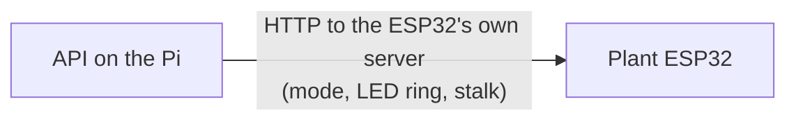

# Concept: the classroom plant

We're building a prototype of a classroom mascot in the form of a physical plant. It reacts live to the air and the noise in the classroom, and it grows with the "water" the class earns for a good learning environment. The teacher controls it through the web app.

## Hardware

| Part                      | Role                                                                                                                                                                                               |
| ------------------------- | -------------------------------------------------------------------------------------------------------------------------------------------------------------------------------------------------- |
| Plant ESP32               | Reads the DHT11 (temperature, humidity) and the LDR (light) and sends the readings to the API. Drives the LED ring and the servos. Polls the API every second for the [noise score](#noise-score). |
| LED ring                  | Shows the CO2 level or the growth, depending on the [mode](#two-modes)                                                                                                                             |
| Servo motors              | Move the stalk: it shrinks when the class is loud, or grows with the water, depending on the [mode](#two-modes)                                                                                    |
| Raspberry Pi              | Runs web, API and Postgres for the demo. Every merge to `main` deploys there.                                                                                                                      |
| Phone with the noise page | Measures noise with the browser microphone (`/noise` in the web app) and sends dB readings to the API                                                                                              |
| Watering can              | Stretch goal: a physical can, if the hardware team has time. Until then the water only exists in the app.                                                                                          |

We have neither a microphone nor a CO2 sensor for the plant, so the prototype uses stand-ins:

- **Noise** comes from the phone page. It replaced the earlier plan of Bluetooth headphones on a second ESP32.
- **CO2** is not measured. The API calculates it from the room volume and the number of people in the room, both fixed demo values.

Treat both as data sources that real sensors can replace later.

## Data flow

Every payload is a schema in `@repo/contracts`.

The plant **pulls** from the API. The first plan was the other way round, with the API pushing to an HTTP server on the ESP32 (see [decision 1](#1-the-plant-pulls-instead-of-the-api-pushing)):

## Two modes

The plant is always in exactly one mode. The LED ring and the stalk never show live feedback and growth at the same time.

|                | Measuring mode                                                     | Watering mode (name not final)                                    |
| -------------- | ------------------------------------------------------------------ | ----------------------------------------------------------------- |
| When           | During lessons                                                     | At the class review at the end of a phase, started by the teacher |
| LED ring       | CO2: the color slowly shifts as the air quality gets worse         | Growth: from green to colorful                                    |
| Stalk (servos) | Shrinks when it gets loud, a hiding motion to make the class quiet | Starts as a sprout and extends as the class pours water           |

## Noise score

In measuring mode the stalk follows the **noise score**, a whole number from 1 (quiet) to 100 (loud). Which dB level counts as loud depends on the **work mode**, which the teacher sets per class (`PUT /api/classes/:id/work-mode`):

| Work mode                          | 1 at and below | 100 at and above |
| ---------------------------------- | -------------- | ---------------- |
| Stillarbeit (`silent`, default)    | 40 dB          | 55 dB            |
| Unterrichtsgespräch (`discussion`) | 50 dB          | 60 dB            |
| Gruppenarbeit (`group`)            | 60 dB          | 80 dB            |

Between the two values the score is linear. The plant polls `GET /api/plants/:id/noise-score` every second, and the API works out the score in two steps:

1. **Target**: the median of the class's noise readings from the last 10 seconds, mapped to 1–100 for the work mode. The median ignores single outliers, like a shout or a covered microphone. Only the first reading per device and second counts, so a client that floods readings can't outvote the others.
2. **Score**: moves toward the target by **at most 3 points per second**, so the plant moves slowly and never jumps. From 100 to 1 takes about 33 seconds.

Without noise readings, for example when the phone is off, the score holds for 60 seconds and then becomes `null`. The plant then stays where it is. The firmware should ease the servo toward each new value instead of jumping, so the movement is smooth between two polls.

The numbers live in `NOISE_RULES` in `@repo/contracts`. Devices choose their own `sensorId`, so someone who fakes many devices gets past the one-reading-per-second rule. Stopping that needs device authentication, which the prototype leaves out.

## Earning water

Points are called **water**. The class collects them over a **measuring phase** of a day or a week (the teacher chooses). There are two ways to earn water:

- **Silent work phase**: the teacher starts a timer in the app, and the noise readings are tracked while it runs. A class that stays quiet the whole time gets a fixed maximum. Otherwise it gets the same percentage of the maximum as the percentage of time it was quiet.
- **Manual award**: the teacher taps "kleine Menge" or "große Menge" in the app.

At the end of the phase the class comes together for the review, and the teacher starts watering mode. The plant goes into the **sprout** state (small, collapsed, green), the class pours in its water, and the plant grows toward **blooming** (colorful, full height) depending on how much water there was. **Growth resets every phase**, so water and growth are stored per class and phase.

## Web app

The web app is the teacher's companion. Planned pages:

1. **Plants and classes**: connect a plant to a class. Each class has exactly one active plant.
2. **Sensor data**: the readings of one class over a chosen time frame, as charts.
3. **Lesson management**: start the silent work phase timer, and add water with the "kleine Menge" / "große Menge" buttons.
4. **Class review**: teacher and class see their progress over the last weeks with a digital version of the plant. The teacher starts watering mode from here.

## Open decisions

- ~~When and how often the API sends to the plant ESP32, and what the payload contains.~~ Decided: the plant polls the noise score every second, see [decision 1](#1-the-plant-pulls-instead-of-the-api-pushing). Still open: how the LED ring gets the CO2 level and the growth.
- The water amounts: the maximum for a silent phase, "kleine Menge", "große Menge", and how much water a full bloom takes.
- The dB level that counts as quiet.
- The CO2 formula and the demo values for room volume and headcount.
- Whether the physical watering can gets built.

## Decisions

Changes to the plan above, newest last. The original idea stays in the text, so it's clear what changed and why.

### 1. The plant pulls instead of the API pushing

**Date**: 2026-10-25

**Originally planned**: the plant ESP32 runs its own HTTP server, and the API sends the mode, the LED ring and the stalk position to it.

**Now**: for the noise score, the plant polls `GET /api/plants/:id/noise-score` every second, and the API smooths the score so it changes by at most 3 points per second.

**Why**:

- The stalk should move slowly and steadily, not jump from 100 to 1 when a loud class suddenly goes quiet. That needs a new value regularly, and polling every second gives exactly that.
- With push, the API would need the IP address of every plant, which can change in the WLAN, and school or hotspot networks often block connections to devices. With pull, the plant only has to reach the API.
- If a poll fails, the plant gets the current value with the next one. With push, the API would have to catch and retry failures.
- The firmware only needs an HTTP client and a timer, not its own server.

**Still possible**: if the team wants push later, the API can send the same smoothed score. The calculation stays the same.
