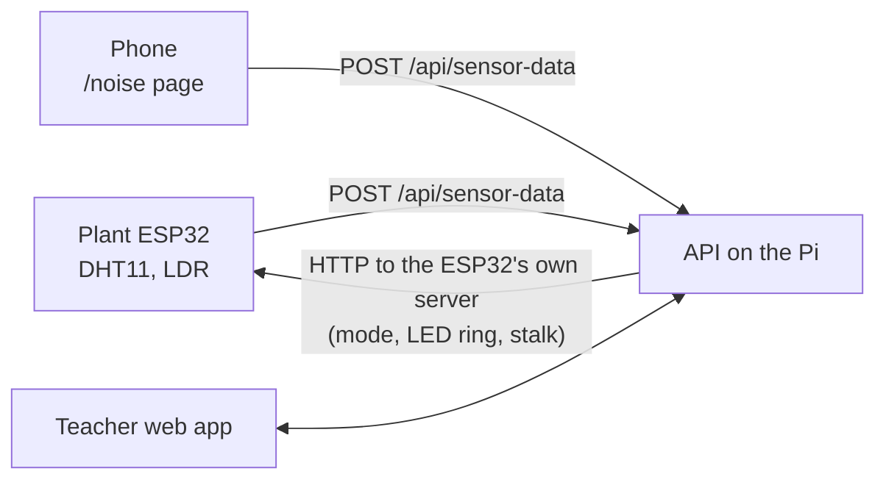

# Concept: the classroom plant

We're building a prototype of a classroom mascot in the form of a physical plant. It reacts live to the air and the noise in the classroom, and it grows with the "water" the class earns for a good learning environment. The teacher controls it through the web app.

## Hardware

| Part                      | Role                                                                                                                                                                                 |
| ------------------------- | ------------------------------------------------------------------------------------------------------------------------------------------------------------------------------------ |
| Plant ESP32               | Reads the DHT11 (temperature, humidity) and the LDR (light) and sends the readings to the API. Drives the LED ring and the servos. Runs its own HTTP server, which the API sends to. |
| LED ring                  | Shows the CO2 level or the growth, depending on the [mode](#two-modes)                                                                                                               |
| Servo motors              | Move the stalk: it shrinks when the class is loud, or grows with the water, depending on the [mode](#two-modes)                                                                      |
| Raspberry Pi              | Runs web, API and Postgres for the demo. Every merge to `main` deploys there.                                                                                                        |
| Phone with the noise page | Measures noise with the browser microphone (`/noise` in the web app) and sends dB readings to the API                                                                                |
| Watering can              | Stretch goal: a physical can, if the hardware team has time. Until then the water only exists in the app.                                                                            |

We have neither a microphone nor a CO2 sensor for the plant, so the prototype uses stand-ins:

- **Noise** comes from the phone page. It replaced the earlier plan of Bluetooth headphones on a second ESP32.
- **CO2** is not measured. The API calculates it from the room volume and the number of people in the room, both fixed demo values.

Treat both as data sources that real sensors can replace later.

## Data flow

Every payload, including the one the API sends to the ESP32, is a schema in `@repo/contracts`.

## Two modes

The plant is always in exactly one mode. The LED ring and the stalk never show live feedback and growth at the same time.

|                | Measuring mode                                                     | Watering mode (name not final)                                    |
| -------------- | ------------------------------------------------------------------ | ----------------------------------------------------------------- |
| When           | During lessons                                                     | At the class review at the end of a phase, started by the teacher |
| LED ring       | CO2: the color slowly shifts as the air quality gets worse         | Growth: from green to colorful                                    |
| Stalk (servos) | Shrinks when it gets loud, a hiding motion to make the class quiet | Starts as a sprout and extends as the class pours water           |

## Earning water

Points are called **water**. The class collects them over a **measuring phase** of a day or a week (the teacher chooses). There are two ways to earn water:

- **Silent work phase**: the teacher starts a timer in the app, and the noise readings are tracked while it runs. A class that stays quiet the whole time gets a fixed maximum. Otherwise it gets the same percentage of the maximum as the percentage of time it was quiet.
- **Manual award**: the teacher taps "kleine Menge" or "große Menge" in the app.

At the end of the phase the class comes together for the review, and the teacher starts watering mode. The plant goes into the **sprout** state (small, collapsed, green), the class pours in its water, and the plant grows toward **blooming** (colorful, full height) depending on how much water there was. **Growth resets every phase**, so water and growth are stored per class and phase.

## Web app

The web app is the teacher's companion. Planned pages:

1. **Plants and classes**: connect a plant to a class. Each class has exactly one active plant.
2. **Sensor data**: the readings of one class over a chosen time frame, as charts.
3. **Lesson management**: start the silent work phase timer, and add water with the "kleine Menge" / "große Menge" buttons.
4. **Class review**: teacher and class see their progress over the last weeks with a digital version of the plant. The teacher starts watering mode from here.

## Open decisions

- When and how often the API sends to the plant ESP32, and what the payload contains.
- The water amounts: the maximum for a silent phase, "kleine Menge", "große Menge", and how much water a full bloom takes.
- The dB level that counts as quiet.
- The CO2 formula and the demo values for room volume and headcount.
- Whether the physical watering can gets built.
